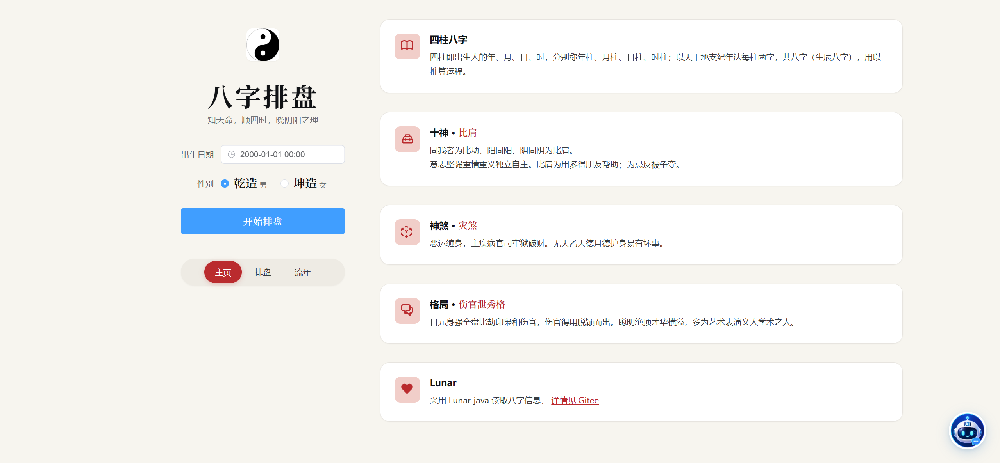
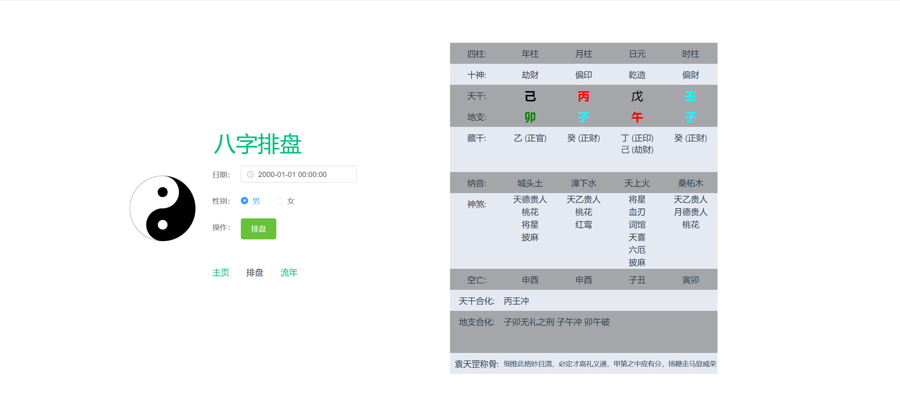
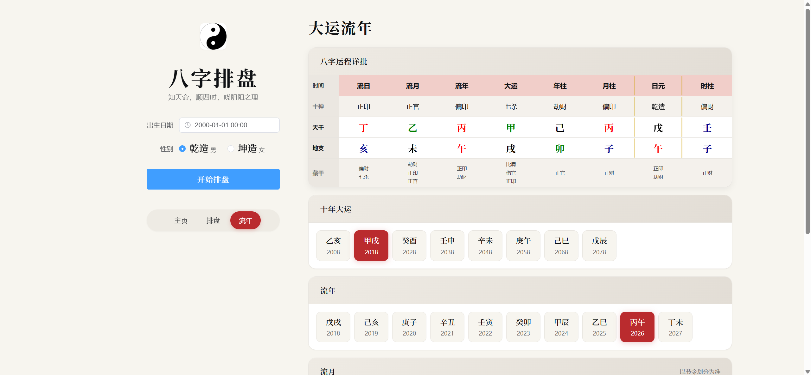

# E-God

#### 介绍
E-God即为eightGod，是一款根据公历日期进行八字排盘的简单工具。年月日时四柱配天干地支共八字，且字字有其阴阳，字字有其神韵，固称之为“八神”。

  

#### 软件架构
| 环境       | 版本    |
| ---------- | ------- |
| jdk        | >=17    |
| springboot | 3.3.3   |
| vue        | ^3.4.29 |

  

#### 启动教程

> 前端

1.  `npm install`
2.  `npm run dev`
3.  后台地址配置在`@/util/request.ts`的baseURL中

> 后端

1. 直接启动`DivinationApplication`，端口默认9369

  

#### 补充说明

1. 目前支持简单排盘和排大运功能

2. 录入神煞：天乙贵人，月德贵人，天德贵人，太极贵人，文昌贵人，国印贵人，天厨贵人,魁罡贵人 天赫贵人，驿马，劫煞，灾煞，桃花，华盖，血刃，学堂，词馆，将星，金舆，天医，红鸾，六厄，披麻，亡神，羊刃，十灵日，童子煞，十恶大败，勾绞煞，红艳煞，丧门，吊客，孤辰，寡宿，阴差阳错，福星贵人，德秀贵人，金神（详情内容请查看神煞说明.md）

   

  

#### 功能预览

|  |
| ---------------------- |
|  |
|  |

